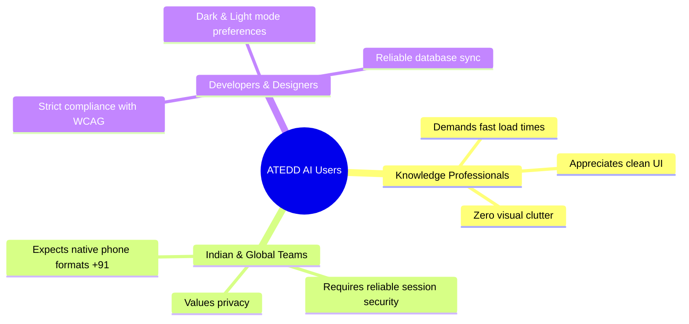
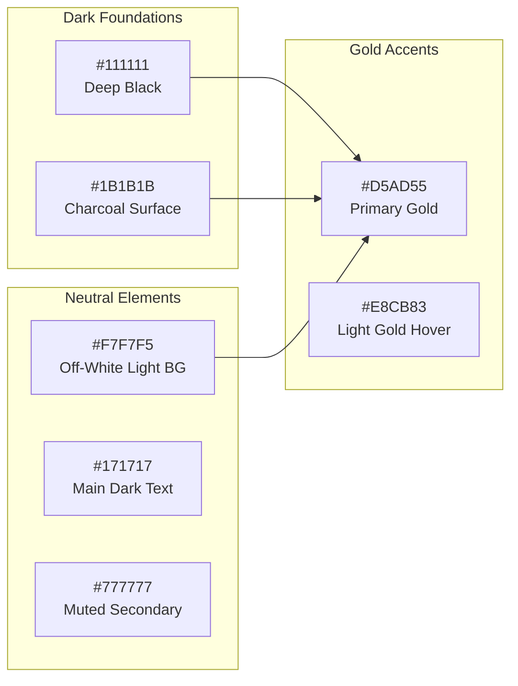
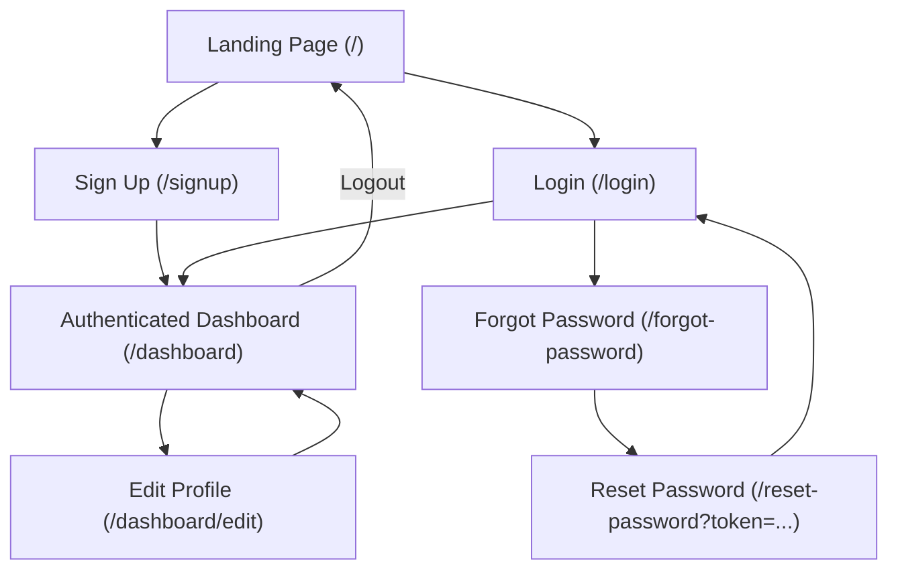
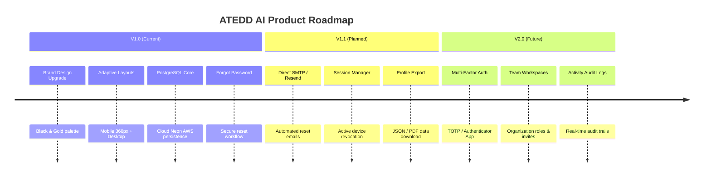

# Product Requirements Document (PRD)
## ATEDD AI — Intelligent Workspace Web Application

---

### Document Control & Metadata

| Attribute | Details |
| :--- | :--- |
| **Product Name** | **ATEDD AI** |
| **Document Version** | 1.0.0 (Production Release) |
| **Document Status** | Approved / Deployed |
| **Target Audience** | Engineering, Product Management, Design, Stakeholders |
| **Live Production URL**| [https://atted-website.vercel.app](https://atted-website.vercel.app) |
| **Repository** | [https://github.com/faisalahmed-byte/ATTED-Website](https://github.com/faisalahmed-byte/ATTED-Website) *(Private)* |
| **Primary Database** | Cloud PostgreSQL (AWS Neon Serverless) |
| **Framework** | Next.js 16 (App Router) + React 19 + TypeScript |

---

## 1. Executive Summary & Vision

### 1.1 Vision Statement
ATEDD AI delivers a minimalist, high-performance intelligent workspace designed for clarity, focus, and security. Combining an elegant black-and-gold visual aesthetic with real-time cloud PostgreSQL persistence and bank-grade session security, ATEDD AI provides a refined digital environment across mobile devices and desktop workstations.

### 1.2 Problem Statement
Modern productivity tools are frequently encumbered by visual clutter, excessive animations, sluggish performance, and opaque data practices. Users demand:
1. Fast, distraction-free authentication and profile management.
2. Direct, reliable data persistence with zero loss.
3. Mobile-first design that adapts seamlessly into full desktop experiences without distortion.
4. Privacy, data ownership, and transparent security without corporate overreach.

### 1.3 Key Value Propositions
- **Curated Black & Gold Aesthetic**: Refined palette prioritizing contrast, readability, and modern minimalism.
- **True PostgreSQL Persistence**: Every user attribute is stored directly in an AWS Neon Cloud PostgreSQL database using Prisma ORM—no mock data.
- **Adaptive Multi-Device Layouts**: Purpose-built responsive views engineered for mobile devices (360px–430px) and wide desktop displays without simulated bezels.
- **Cryptographic Security**: Salted bcrypt password hashing (12 rounds), HTTP-only JWT sessions, and time-bound password reset tokens.

---

## 2. User Personas



### Primary Persona: The High-Performing Professional
- **Demographics**: 24–45 years old, software engineers, product managers, designers, executives.
- **Goals**: Access workspace credentials securely, manage personal profiles with custom avatars, update phone and bio without friction.
- **Pain Points**: Cramped mobile interfaces, slow database updates, hard-to-read low-contrast typography, and insecure password recovery.

---

## 3. Brand Identity & Design System

The design system follows strict guidelines prioritizing elegance, minimalism, and high contrast.

### 3.1 Color Palette Tokens



| Token Name | Hex Code | Primary Usage |
| :--- | :--- | :--- |
| **Deep Black** | `#111111` | Dark mode background, logo backgrounds, high-contrast badges |
| **Charcoal** | `#1B1B1B` | Dark mode cards, elevated surfaces, input backgrounds |
| **Primary Gold** | `#D5AD55` | Primary CTA buttons, active focus rings, brand badges, avatar borders |
| **Light Gold** | `#E8CB83` | Hover states for primary buttons and interactive links |
| **Off-White** | `#F7F7F5` | Light mode primary background, dark mode headings |
| **Pure White** | `#FFFFFF` | Light mode cards and input surfaces |
| **Main Text (Dark)** | `#171717` | High-contrast body text in light mode |
| **Secondary Text** | `#777777` | Captions, hints, neutral icons, borders |

### 3.2 Typography Standards
- **Font Family**: Inter, `-apple-system`, `BlinkMacSystemFont`, `Segoe UI`, `sans-serif`.
- **Headlines**: Extra-bold (`font-extrabold`), tracking-tight (`tracking-tight`), line-height 1.15–1.25.
- **Body Text**: 14px–16px, line-height 1.5–1.6, color `#171717` (light) / `#F7F7F5` (dark).
- **Form Inputs**: Strictly **16px minimum font size** to prevent iOS Safari auto-zoom on input focus.

### 3.3 Touch Targets & Ergonomics
- **Buttons & Inputs**: Minimum height of `48px` on mobile for thumb reachability.
- **Borders**: Hairline `1px` (`#E8E8E6` in light, `#2A2A2A` in dark).
- **Focus States**: 2px ring using `#D5AD55` with 30% alpha (`focus:ring-[#D5AD55]/30`).

---

## 4. Information Architecture & Navigation



### Route Access Matrix

| Route | Access Level | Description | Redirect Target (If Unauth) |
| :--- | :---: | :--- | :---: |
| `/` | Public | Brand landing hero and primary actions | — |
| `/login` | Public | Account authentication | `/dashboard` (if auth) |
| `/signup` | Public | New account registration | `/dashboard` (if auth) |
| `/forgot-password` | Public | Reset link dispatch request | — |
| `/reset-password` | Public (Token-Gated) | Cryptographic password update | `/forgot-password` (if no token) |
| `/dashboard` | **Protected** | User profile overview and system status | `/login?from=/dashboard` |
| `/dashboard/edit` | **Protected** | Profile editor (photo, bio, phone, name) | `/login?from=/dashboard/edit` |

---

## 5. Detailed Feature Specifications

### 5.1 Landing Page (`/`)
- **Hero Section**:
  - Prominent circular gold ATEDD AI emblem.
  - Headline: `Welcome to ATEDD AI`.
  - Subtitle: *"Empowering your workflow with intelligent clarity, speed, and seamless precision."*
- **Action Buttons**:
  - Primary CTA: Solid Gold (`#D5AD55`) button with dark text &rarr; navigates to `/signup`.
  - Secondary CTA: Refined neutral bordered button &rarr; navigates to `/login`.
- **Header & Footer**:
  - Brand identity pill + Theme Toggle (Light/Dark).
  - Security reassurance: `Your data is secure • ATEDD AI`.

### 5.2 User Registration (`/signup`)
- **Fields**:
  1. `Full Name`: Required, min 2 chars, max 80 chars. Neutral placeholder `Enter your full name`.
  2. `Email Address`: Required, standard email validation, normalized to lowercase.
  3. `Phone Number`: Optional, validated up to 25 chars. Standard Indian placeholder: `+91 98765 43210` with hint `Optional (e.g. +91 98765 43210)`.
  4. `Password`: Required, min 8 chars, max 100 chars, includes toggleable eye icon.
- **Workflow**:
  - Upon valid submission, `POST /api/auth/signup` creates the user in PostgreSQL and automatically creates a session token, redirecting the user directly to `/dashboard`.

### 5.3 User Authentication (`/login`)
- **Fields**:
  1. `Email Address`: Neutral placeholder `name@example.com`.
  2. `Password`: Neutral placeholder `Enter your password` with visibility toggle.
- **Forgot Password**: Positioned directly below the password input, aligned right, leading to `/forgot-password`.
- **Banners**:
  - Displays green confirmation banner when arriving from `?reset=success` or `?registered=true`.
  - Displays red alert on invalid credentials.

### 5.4 Forgot Password & Reset Password Workflow
- **Forgot Password Request (`/forgot-password`)**:
  - Collects registered email address.
  - Invokes `POST /api/auth/forgot-password`.
  - Issues a cryptographically signed JWT token with a 15-minute expiration time.
  - Presents a success confirmation with a direct action button: `Proceed to Reset Password`.
- **Set New Password (`/reset-password?token=...`)**:
  - Validates token presence and cryptographic signature on load.
  - Inputs: `New Password` and `Confirm New Password` (must match, min 8 chars).
  - Invokes `POST /api/auth/reset-password`, hashes password with bcrypt salt 12, and updates PostgreSQL.
  - Redirects to `/login?reset=success`.

### 5.5 Authenticated Dashboard (`/dashboard`)
- **Welcome Banner**: Displays Title Case personalized greeting (`Welcome back, {FirstName} 👋`).
- **Profile Overview Card**:
  - User Avatar with gold border ring (`#D5AD55`) and live active indicator.
  - Formatted Display Name and email badge.
  - Subtle gold accent divider (`bg-[#D5AD55]/50`).
  - Phone field showing user's phone or clean fallback (*"No phone number added"*).
  - Bio field showing user's bio or empty state (*"No bio provided yet"*).
  - Member Since date formatted in Indian locale (`toLocaleDateString("en-IN")`).
- **Actions**:
  - `Edit Profile` (Primary Gold button).
  - `Logout` (Secondary button that calls `POST /api/auth/logout`, clears session cookie, and redirects to `/`).

### 5.6 Profile Editor (`/dashboard/edit`)
- **Photo Upload / Preset Selection**:
  - File upload supporting JPEG, PNG, WEBP (under 2MB, converted to base64 DataURI).
  - 4 quick preset avatar options with gold selection ring.
  - Option to remove current photo.
- **Editable Attributes**:
  - `Full Name`: Real-time validation.
  - `Email Address`: Read-only with lock indicator to maintain account identity.
  - `Phone Number`: Validated optional field with Indian format placeholder.
  - `Personal Bio`: Multi-line textarea with live `250` character countdown counter.
- **Save Changes**:
  - Calls `PATCH /api/user/profile`, updates PostgreSQL, and redirects back to `/dashboard` with immediate UI synchronization.

---

## 6. Technical Architecture & Database Schema

```mermaid
flowchart TD
    Client["Browser Client (Mobile & Desktop)"]
    NextServer["Next.js 16 Server (App Router)"]
    AuthModule["Auth Module (bcrypt + jose JWT)"]
    PrismaORM["Prisma Client ORM"]
    PostgreSQL["AWS Neon PostgreSQL Serverless DB"]

    Client -->|HTTPS / Next.js Proxy| NextServer
    NextServer --> AuthModule
    NextServer --> PrismaORM
    PrismaORM -->|Connection Pooler (port 5432)| PostgreSQL
```

### 6.1 Database Schema (Prisma ORM)

```prisma
model User {
  id           String   @id @default(uuid())
  email        String   @unique
  name         String
  passwordHash String
  avatarUrl    String?
  phone        String?
  bio          String?
  createdAt    DateTime @default(now())
  updatedAt    DateTime @updatedAt

  @@map("users")
}
```

### 6.2 Security Specifications
1. **Password Hashing**: `bcryptjs` with salt round `12`. Passwords are never stored in plain text.
2. **Session Storage**: Encrypted JWT stored inside an `httpOnly`, `sameSite=lax`, `secure` (in production) cookie (`ated_session`) with 7-day expiration.
3. **Route Protection**: Next.js proxy middleware intercepting unauthenticated access to `/dashboard` and `/dashboard/edit`, preserving deep links via `?from=` parameter.
4. **Environment Isolation**: `.env` is tracked in `.gitignore`. Production variables are encrypted in Vercel Project Settings.

---

## 7. Verification & Testing Matrix

| Feature / User Flow | Verification Method | Status |
| :--- | :--- | :---: |
| **Landing Page Load** | HTTP 200, checks ATEDD AI logo & CTA buttons | **PASS** |
| **Registration Flow** | Creates user with `+91 98765 43210` in PostgreSQL | **PASS** |
| **Duplicate Email Prevention** | Rejects identical registration with HTTP 409 | **PASS** |
| **Short Password Rejection** | Rejects passwords < 8 chars with HTTP 400 | **PASS** |
| **Authentication Flow** | Generates valid `ated_session` HTTP-only cookie | **PASS** |
| **Dashboard Personalization** | Title Case greeting, displays phone and email | **PASS** |
| **Profile Mutation** | Updates bio, phone, and avatar in PostgreSQL | **PASS** |
| **Forgot Password Request** | Generates 15-min signed reset token | **PASS** |
| **Password Reset Flow** | Updates `passwordHash` in PostgreSQL; rejects old password | **PASS** |
| **Route Guarding** | Unauthorized `/dashboard` redirected with HTTP 307 | **PASS** |
| **Responsive Viewports** | Verified at 360px, 375px, 390px, 414px, 430px, 1440px | **PASS** |

---

## 8. Release Roadmap (Future Scope)


